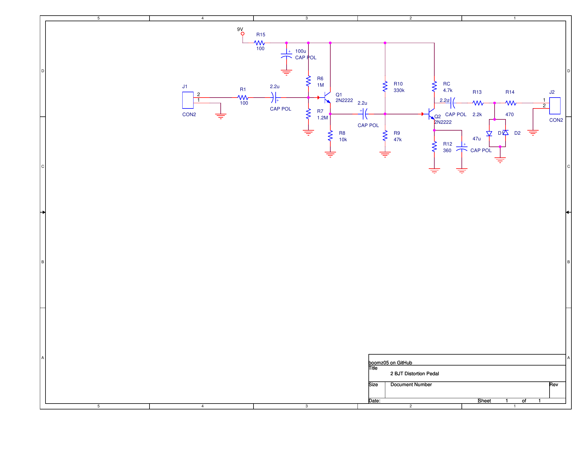
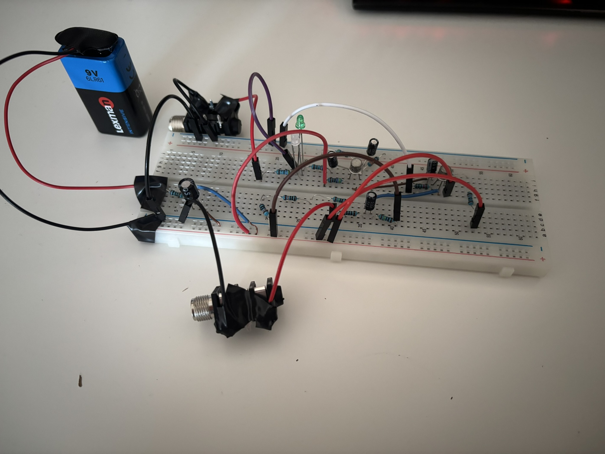
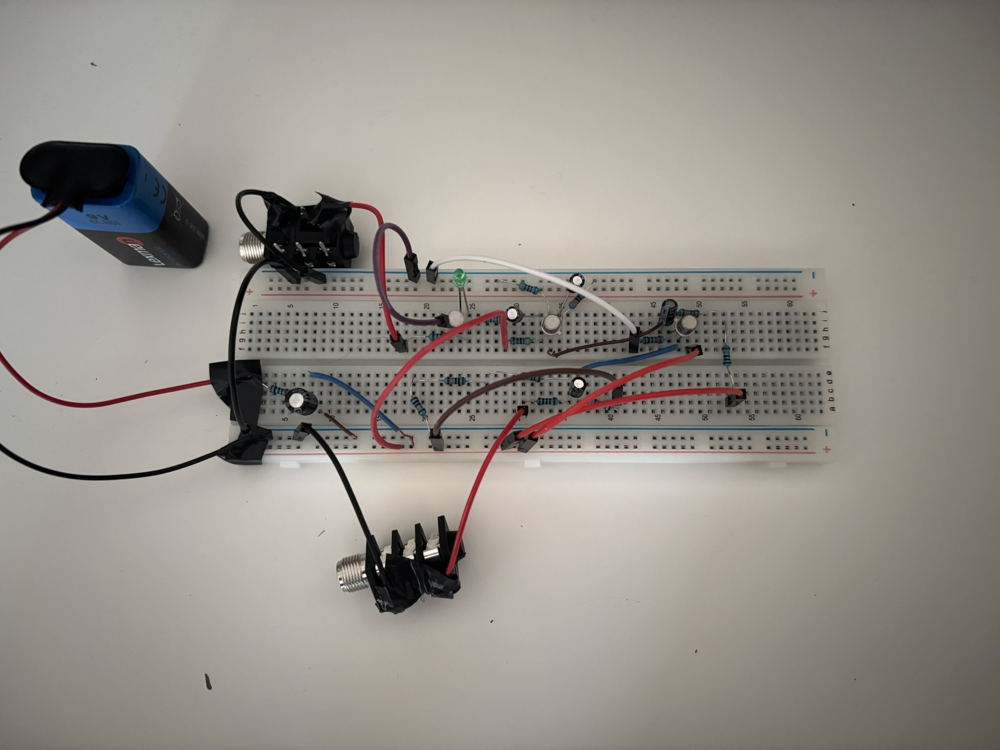

# Bass Distortion Pedal

[](#license)
[](#overview)
[](#circuit-architecture)
[](#design-files)
[](#simulation)

An analog bass distortion pedal designed, simulated, assembled, and tested as a student hardware project. I wanted to build a real pedal for a bass guitar, but commercial distortion pedals can be relatively expensive. Instead, I designed and built one with components already available at home. The project kept the additional cost low while providing a practical way to learn analog electronics through circuit design, transistor biasing, simulation, debugging, and hands-on testing.

---

## Overview

| Item | Description |
| --- | --- |
| Application | Passive bass guitar distortion |
| Circuit | Two-transistor BJT design with diode clipping |
| Supply | 9 V battery |
| Prototype | Breadboard implementation |
| Design tools | OrCAD Capture CIS and TINA-TI-compatible SPICE simulation |

<p align="center">
  <a href="hardware/schematic/bass-distortion-pedal-schematic.pdf">
    
  </a><br>
  <em>Figure 1. Reconstructed circuit schematic. Select the image for the PDF.</em>
</p>

## Features

- High input impedance suited to passive bass pickups
- Discrete BJT design using two 2N2222 transistors
- Single 9 V battery supply with RC filtering
- Diode-clipping output stage
- AC-coupled signal path
- Breadboard prototype tested with a bass guitar and amplifier

## Circuit Architecture

| Stage | Function |
| --- | --- |
| Input network | Couples the instrument signal and limits input current. |
| Q1 - emitter follower | Buffers the passive pickup with a high input impedance. |
| Q2 - common-emitter amplifier | Provides the voltage gain needed to drive the clipping stage. |
| Clipping network | Uses anti-parallel diodes to limit the output waveform and generate distortion. |
| Output network | AC-couples the clipped signal to the output jack. |
| Supply filter | Uses a series resistor and capacitor to reduce battery-supply noise. |

## Design Considerations

The circuit design considered the following before hardware assembly:

- DC operating-point calculations and transistor bias optimization
- Input-impedance optimization for passive bass pickups
- AC frequency-response simulation
- Coupling-capacitor sizing
- Supply filtering
- Clipping-threshold selection

## Simulation

The circuit was originally simulated in **TINA-TI** before implementation. The reconstructed, TINA-TI-importable SPICE source is available at [`simulation/tina-ti/bass-distortion-pedal.cir`](simulation/tina-ti/bass-distortion-pedal.cir).

The netlist includes setups for:

- DC operating point
- AC transfer characteristic
- Time-domain waveform analysis

These analyses support verification of transistor bias points, frequency response, and clipping behavior before breadboard assembly.

## Hardware Implementation

The circuit was assembled on a breadboard and powered from a 9 V alkaline battery. Testing used a passive bass guitar, bass amplifier, and digital multimeter. During debugging, the base, collector, and emitter voltages of both transistors were checked against the intended operating points.

<p align="center">
  
  <br>
  <em>Figure 2. Breadboard prototype: overview (left) and top view (right).</em>
</p>

## Audio Demo

- [Clean signal](assets/audio/clean-signal.m4a)
- [Distorted signal](assets/audio/distorted-signal.m4a)

## Challenges Encountered

- The original 1N4148 clipping diodes were faulty during breadboard debugging, so LEDs were used in the physical prototype instead.
- Breadboard wiring introduced noise; a future PCB would reduce wiring length and improve repeatability.

## Project Cost

Most parts were already available. Only the following items were purchased for this project:

| Purchased item | Cost |
| --- | ---: |
| 2 x mono jack connectors | 8 RON |
| Capacitor assortment | 12 RON |
| Resistor assortment | 14 RON |
| **Total** | **34 RON (approximately EUR 7)** |

The effective project cost is low because the remaining components, including the transistors, battery, breadboard, and wiring, were already owned.

## Bill of Materials

See the complete [Bill of Materials](BOM.md).

## Design Files

- [OrCAD Capture project](hardware/orcad/bass-distortion-pedal.opj)
- [Schematic PDF](hardware/schematic/bass-distortion-pedal-schematic.pdf)
- [Simulation netlist](simulation/tina-ti/bass-distortion-pedal.cir)

## Technologies Used

- OrCAD Capture CIS Lite
- TINA-TI
- 2N2222 BJT transistors
- Breadboard
- Digital multimeter

## Future Improvements

- PCB design in OrCAD
- Tone control
- Adjustable gain
- True-bypass switching
- Metal enclosure
- LED status indicator

## Repository Structure

```text
.
|-- README.md
|-- BOM.md
|-- assets/
|   |-- audio/
|   `-- images/
|-- hardware/
|   |-- orcad/
|   `-- schematic/
`-- simulation/
    `-- tina-ti/
```

## License

No license has been selected for this repository yet. Please contact the repository owner before reusing the design files.
